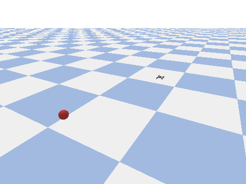
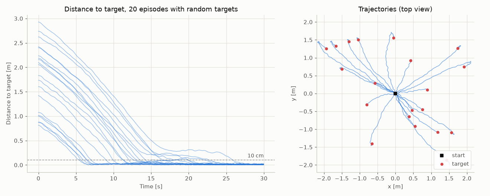

# rl-drone

A quadrotor trained with Proximal Policy Optimization (PPO) to fly to a randomly placed marker in a PyBullet simulation ([gym-pybullet-drones](https://github.com/learnsyslab/gym-pybullet-drones)).

PPO (GAE, clipped surrogate objective, entropy bonus, Gaussian actor) is implemented from scratch in PyTorch, without an RL library. The policy outputs position targets, which the `DSLPIDControl` inner controller turns into motor commands.



*One episode of the pretrained policy, rendered headless at 2x speed: the drone flies to the red marker, blue dots trace its path.*



*20 episodes with random markers 0.8–2.9 m away: all reach the marker within 10 cm without leaving the flight volume; after 30 s the median distance is 1.1 cm (max 2.5 cm).*

## How it works

**Environment** (`FollowMarkerEnv`)
- The marker spawns at a random position each episode (x, y in ±2 m, z in 0.3–2.5 m)
- Observation: drone position relative to the marker (x, y, z) + drone velocity (vx, vy, vz)
- Action: position offset [dx, dy, dz] (action space ±1 m); the PID controller tracks a waypoint at most 5 cm from the drone toward that point
- Reward: negative Euclidean distance to the marker, with a small penalty for flying away from it
- The episode ends when the drone leaves the flight volume

On `main` the observation uses the ground-truth marker position; a camera-based variant (HSV color detection of the marker, plus a yaw action) exists only on the [`yaw-action-space`](https://github.com/alexanderrief/rl-drone/tree/yaw-action-space) branch.

**PPO agent** (`src/rl/`)
- Actor: MLP (two hidden layers of 128) outputting a Gaussian distribution over actions
- Critic: MLP (same layout) estimating the state value V(s)
- Advantage estimation via GAE (γ = 0.95, λ = 0.95)
- Clipped surrogate objective (ε = 0.1) with entropy bonus

## Setup

Use Python 3.11: `pybullet` ships prebuilt wheels only up to 3.11 (newer versions build it from source and need a C++ compiler), and the pinned NumPy needs at least 3.11.

```bash
python3.11 -m venv .venv && source .venv/bin/activate
pip install -r requirements.txt
```

`gym-pybullet-drones` is not on PyPI, so `requirements.txt` installs it from GitHub, pinned to v2.1.0.

## Training

```bash
python train.py -r my_run
```

Resume from a checkpoint:

```bash
python train.py -r my_run -l my_run
```

Checkpoints are saved to `parameters/<run_name>/`.

## Evaluation

A pretrained checkpoint is included in `pretrained/`. To run it directly:

```bash
python show_off.py -l pretrained
```

Or use your own checkpoint:

```bash
python show_off.py -l my_run
```

Opens the PyBullet GUI and plots drone position and speed over 2000 steps (also saved as `flight_data.png` in the checkpoint folder).

To regenerate the figures above without a display (PyBullet DIRECT mode, seeded):

```bash
python scripts/make_figures.py
```

## Tests

```bash
pytest
```
